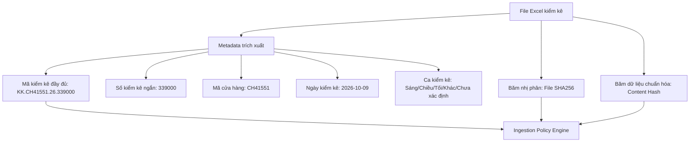

# ĐỊNH DANH SNAPSHOT & CHÍNH SÁCH DEDUPLICATION (SNAPSHOT IDENTITY)

**Dự án:** Quản lý & Đối soát Tồn kho (Vinamilk)  
**Round:** 01/10  
**Vai trò thực hiện:** Data Engineer  
**Trạng thái:** Confirmed & Verified  

---

## 1. MÔ HÌNH ĐỊNH DANH SNAPSHOT KIỂM KÊ

Mỗi file kiểm kê nạp vào hệ thống đại diện cho một **Snapshot trạng thái tồn kho** tại một thời điểm xác định. Để giải quyết trọn vẹn bài toán:
- Nhiều file trong cùng 1 ngày (ví dụ: ngày 09/10/2026 có cả file 339000 và file 339513);
- Các ca kiểm kê khác nhau (Sáng / Chiều / Tối);
- Khác cửa hàng hoặc phạm vi kho;
- Nạp trùng lặp từ cả Web Upload và Google Drive Sync;

Hệ thống thiết lập mô hình định danh đa cấp như sau:

### Các trường định danh cốt lõi (Core Identity Fields):

1. **Mã kiểm kê đầy đủ (`full_code`):**
   - Định dạng: `KK.{store_code}.{year}.{ticket_number}`
   - Ví dụ: `KK.CH41551.26.339000`
   - Đảm bảo tính duy nhất trên toàn hệ thống cho một lần xuất kiểm kê của một cửa hàng.
2. **Số kiểm kê ngắn (`ticket_number`):**
   - Chuỗi số nguyên nhận diện nhanh, ví dụ: `339000`, `339513`, `339931`, `340231`.
3. **Mã cửa hàng (`store_code`):**
   - Nhận diện cửa hàng hoặc chi nhánh thực hiện kiểm kê, ví dụ: `CH41551`.
4. **Ngày kiểm kê (`inventory_date`):**
   - Trích xuất từ hậu tố tên file (`YYYYMMDD`), ví dụ: `2026-10-09`.
   - **Lưu ý:** Không tự động suy diễn ngày kiểm kê từ ngày giờ sửa đổi của Google Drive (Drive modified time) vì có thể bị làm mới khi copy/di chuyển file.
5. **Ca kiểm kê (`shift`):**
   - Giá trị enum: `Sáng`, `Chiều`, `Tối`, `Khác`, `Chưa xác định`.
   - Mặc định khởi tạo là `Chưa xác định` trừ khi người dùng chủ động chọn khi import hoặc cập nhật qua màn hình chỉnh sửa metadata có audit log.
   - Tuyệt đối không tự tiện suy đoán ca dựa trên giờ xuất file POI nếu chưa được cấu hình quy tắc xác nhận.
6. **File SHA256 (`file_sha256`):**
   - Checksum băm trên dữ liệu nhị phân của file gốc.
7. **Content Hash (`content_hash`):**
   - Checksum SHA256 tính trên mảng dữ liệu sản phẩm `[(product_code, warehouse, quantity, unit_price, total_amount)]` đã sắp xếp theo thứ tự chuẩn.
   - Giúp nhận diện chính xác 2 file có nội dung hoàn toàn giống nhau ngay cả khi file bị lưu lại (re-saved) làm thay đổi timestamp nội bộ và binary checksum.

---

## 2. QUY TẮC CẤM GỘP DỮ LIỆU CÙNG NGÀY

> [!IMPORTANT]
> **Quy tắc bất biến:** Một ngày có thể có nhiều đợt kiểm kê (ví dụ: ca sáng xuất 339000, ca chiều xuất 339513).
> Hệ thống **TUYỆT ĐỐI KHÔNG ĐƯỢC CỘNG DỒN** số lượng tồn của 2 file cùng ngày thành một tổng tồn gộp. Mỗi snapshot là một lát cắt độc lập của kho hàng. Mọi phép so sánh giữa 339000 và 339513 là phép so sánh biến động nội ngày (Intra-day Inventory Movement).

---

## 3. MA TRẬN CHÍNH SÁCH TIẾP NHẬN DỮ LIỆU (INGESTION STATE MACHINE)

Khi một file Excel được nạp vào hệ thống (từ Web hoặc Drive Sync), hệ thống đối chiếu metadata với cơ sở dữ liệu hiện hữu theo bảng quyết định sau:

| Trạng thái xác định | Điều kiện nhận diện | Hành vi hệ thống | Giải thích nghiệp vụ |
|---|---|---|---|
| **`NEW`** | `full_code` chưa từng tồn tại trong hệ thống. | Cho phép nạp vào Staging và commit thành công. | Chứng từ kiểm kê mới hợp lệ. |
| **`ALREADY_IMPORTED`** | `full_code` đã tồn tại VÀ `file_sha256` trùng khớp 100%. | Bỏ qua việc ghi mới, trả về mã snapshot hiện hữu kèm thông báo "File đã được nạp". | Trùng lặp hoàn toàn nhị phân (vd: Drive sync quét lại file cũ). |
| **`DUPLICATE`** | `full_code` đã tồn tại VÀ `content_hash` trùng khớp 100% (dù binary hash khác do re-save). | Bỏ qua việc ghi mới, ghi log cảnh báo trùng lặp nội dung. | Tránh nhân bản dữ liệu rác khi cùng 1 kỳ kiểm kê bị tải lên nhiều lần. |
| **`CONFLICT`** | `full_code` đã tồn tại NHƯNG `content_hash` KHÁC NHAU. | **TỪ CHỐI GHI ĐÈ**. Báo trạng thái `CONFLICT`. Yêu cầu Admin xử lý thủ công. | Cùng mã kiểm kê nhưng số liệu thay đổi. Ngăn chặn nguy cơ ghi đè âm thầm làm sai lệch số liệu kế toán. |
| **`SOFT_DELETED`** | Snapshot đã bị Admin đánh dấu xóa mềm (`is_deleted = true`). | **TỪ CHỐI TỰ ĐỘNG PHỤC HỒI**. Ghi nhận log bỏ qua. | Đảm bảo tính toàn vẹn quyết định của Admin: Drive Sync gặp lại file đã xóa sẽ không được phép tự ý đưa file đó trở lại danh sách hoạt động. |

---

## 4. XỬ LÝ KHÁC CỬA HÀNG / KHÁC PHẠM VI KHO

1. Nếu người dùng chọn so sánh giữa 2 snapshot khác mã cửa hàng (ví dụ: `CH41551` vs `CH41552`):
   - Hệ thống vẫn tính toán sự chênh lệch theo mã sản phẩm nếu được yêu cầu.
   - Hệ thống **bắt buộc hiển thị cảnh báo màu vàng (Warning Alert)**: *"Hai chứng từ thuộc hai cửa hàng/phạm vi kho khác nhau. Chênh lệch này thể hiện sự khác biệt danh mục tồn kho, không đại diện cho biến động xuất-nhập luân chuyển."*
