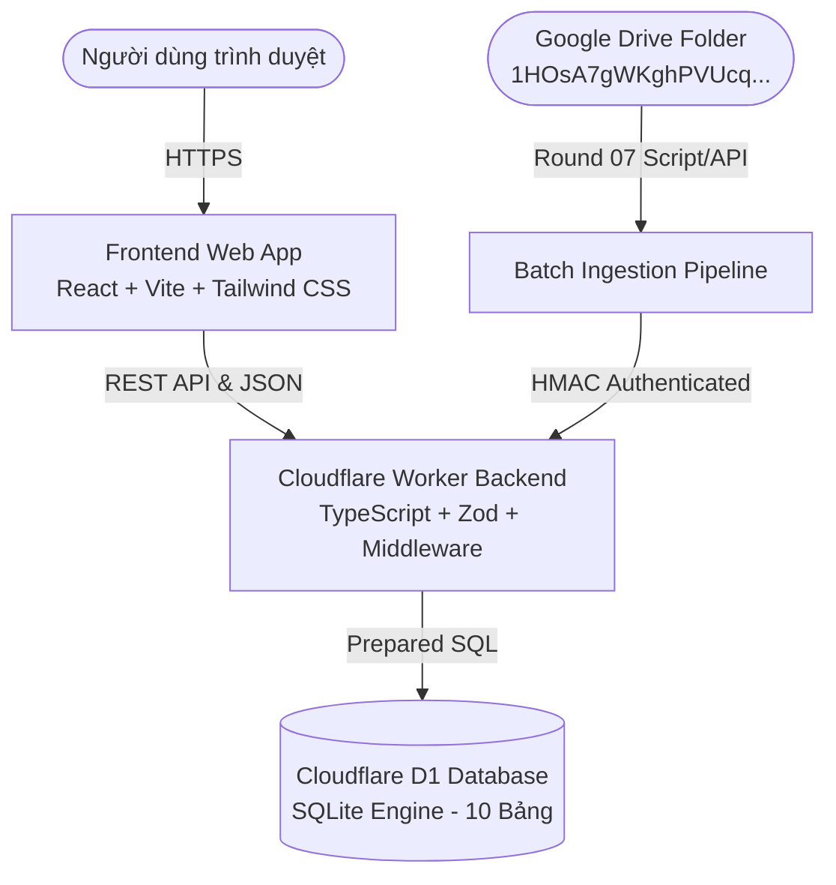

# TÀI LIỆU KIẾN TRÚC HỆ THỐNG (ARCHITECTURE DOCUMENT)

**Dự án:** Quản lý & Đối soát Tồn kho (Vinamilk)  
**Giai đoạn:** Round 02/10 – Project Foundation, Database & API  
**Phiên bản:** 1.0  
**Tác giả:** Backend Developer & Data Engineer  

---

## 1. TỔNG QUAN KIẾN TRÚC (SYSTEM ARCHITECTURE)

Hệ thống được thiết kế theo mô hình **Serverless Edge Architecture** hiện đại, tối ưu hóa cho nền tảng Cloudflare Free Tier nhằm đạt hiệu năng tối đa, chi phí vận hành 0 đồng và độ trễ thấp.

---

## 2. STACK CÔNG NGHỆ CHỌN LỌC

| Tầng hệ thống | Công nghệ sử dụng | Lý do lựa chọn |
|---|---|---|
| **Frontend Web** | React 18, Vite 5, TypeScript, Tailwind CSS, TanStack Query | Tốc độ tải trang dưới 1 giây, bundle nhỏ gọn (~198 KB js, ~16 KB css), typography Inter và bảng màu SaaS sang trọng. |
| **Backend API** | Cloudflare Workers, TypeScript | Chạy trên mạng lưới Edge toàn cầu, khởi động < 5ms, tương thích native Web Request/Response APIs. |
| **Database** | Cloudflare D1 (SQLite Engine) | Serverless relational DB, hỗ trợ chuẩn SQL, foreign keys, ACID transactions, backup tự động. |
| **Data Validation** | Zod v3 | Schema validation đồng bộ giữa client và server thông qua `@inventory/shared`. |
| **Testing Harness** | Python pytest + Node native runner | Kiểm thử toàn diện từ logic nghiệp vụ Excel, so sánh số liệu, đến integration test cho migrations và API routes. |

---

## 3. THIẾT KẾ CƠ SỞ DỮ LIỆU (10 BẢNG CLOUDFLARE D1)

Hệ thống triển khai 10 bảng cơ sở dữ liệu quan hệ chặt chẽ:

1. **`stores`**: Quản lý cửa hàng (mã định danh `store_code`, e.g., `'CH41551'`).
2. **`stock_scopes`**: Quản lý phạm vi kho (`scope_code`, e.g., `'MAIN_STORE'`).
3. **`users`**: Tài khoản người dùng (ADMIN, USER), mật khẩu băm, cờ `must_change_password`.
4. **`sessions`**: Quản lý phiên làm việc, token UUID ngẫu nhiên bảo mật, hỗ trợ thu hồi tức thì.
5. **`product_catalog`**: Danh mục sản phẩm chuẩn hóa, mã sản phẩm `product_code` là chuỗi text bảo toàn số 0 đầu.
6. **`inventory_files`**: Bảng gốc lưu thông tin chứng từ kiểm kê (Snapshot):
   - Không dùng ngày làm khóa duy nhất (`inventory_date` độc lập với khóa chính).
   - Khóa duy nhất là `full_code` (e.g. `'KK.CH41551.26.339000'`).
   - Lưu trữ cặp mã băm: `file_sha256` (băm nhị phân) và `content_hash` (băm dữ liệu chuẩn hóa).
   - Hỗ trợ xóa mềm qua `is_deleted`, `deleted_at`, `deleted_by`.
7. **`inventory_items`**: Chi tiết 15 cột sản phẩm theo Data Contract:
   - Khóa tự nhiên: `UNIQUE(file_id, product_code, warehouse)`.
   - Ràng buộc: `quantity >= 0`, `unit_price >= 0`, `total_amount >= 0`, `conversion_rate > 0`.
8. **`sync_sources`**: Cấu hình nguồn đồng bộ Google Drive (`folder_id`: `1HOsA7gWKghPVUcq2JgUhS9xgiccjp4bk`).
9. **`sync_runs`**: Lịch sử nhật ký từng đợt quét và đồng bộ dữ liệu.
10. **`audit_logs`**: Nhật ký kiểm toán mọi hành động tạo, sửa, xóa mềm, phục hồi snapshot.

---

## 4. CHIẾN LƯỢC ĐỐI SOÁT & DEDUPLICATION

1. **Hỗ trợ Đa Snapshot cùng ngày:**
   - Ngày 09/10/2026 xuất hiện cả 2 snapshot: 339000 (Ca Sáng, 16,961 tồn) và 339513 (Ca Chiều, 17,090 tồn).
   - Cả 2 được lưu trữ độc lập dưới dạng 2 bản ghi riêng biệt trong `inventory_files`.
   - Phép so sánh giữa 2 snapshot cùng ngày đại diện cho biến động luân chuyển trong ngày (Intra-day Inventory Movement).
2. **Chính sách Ingestion State Machine:**
   - `NEW`: Chứng từ mới, cho phép nạp.
   - `ALREADY_IMPORTED`: File nhị phân trùng khớp SHA256, báo đã nạp thành công.
   - `DUPLICATE`: Nội dung dữ liệu trùng khớp (dù file hash khác do re-save), bỏ qua ghi rác.
   - `CONFLICT`: Cùng mã chứng từ nhưng dữ liệu kiểm kê bị thay đổi $\rightarrow$ TỪ CHỐI ghi đè âm thầm, yêu cầu Admin giải quyết.
   - `SOFT_DELETED`: File đã xóa mềm sẽ không tự động sống lại khi Drive Sync quét lại.

---

## 5. ĐÁNH GIÁ TÍNH KHẢ THI TRÊN CLOUDFLARE FREE TIER

- **Giới hạn Workers:** 100,000 requests/ngày (dư thừa cho nhu cầu nội bộ cửa hàng/chuỗi kiểm kê).
- **CPU Time:** 10ms CPU per request. Việc parse Excel nặng được thực hiện ở Client-side (cho Upload) hoặc Google Apps Script (cho Drive Sync), Worker chỉ nhận mảng JSON chuẩn hóa, bảo đảm xử lý dưới 5ms CPU.
- **Giới hạn D1 Database:** 5,000,000 rows read/ngày, 100,000 rows write/ngày, 5 GB storage. Mỗi snapshot trung bình ~434 dòng, 1 năm kiểm kê hàng ngày chỉ tiêu tốn ~150,000 dòng ghi, hoàn toàn nằm trong giới hạn miễn phí trọn đời của Cloudflare.

---

## 6. HỢP ĐỒNG ĐỊNH TUYẾN DEPLOYMENT VÀ ĐỘ CHÍNH XÁC TIỀN TỆ (FIX 02)

### 6.1. Hợp đồng Định tuyến Frontend (Pages) và Backend (Workers)
- **Phương án 1 (Same-Origin - Đề xuất):** Frontend build Vite deploy lên Cloudflare Pages. File `apps/web/public/_routes.json` chỉ định router chuyển tiếp `/api/*` tới Pages Function proxy `apps/web/functions/api/[[catchall]].ts`. Proxy sử dụng trực tiếp Service Binding `API_WORKER` hoặc fetch `API_WORKER_URL`, loại bỏ nhu cầu CORS phức tạp ở production.
- **Phương án 2 (Cross-Origin):** Frontend đọc biến `VITE_API_BASE_URL` (ví dụ `https://api.inventory.vinamilk.com/api`). Phía Worker khai báo `ALLOWED_ORIGINS` khớp chính xác domain frontend. API Client luôn gửi kèm `credentials: "include"` để hỗ trợ cookie auth tại Round 03.

### 6.2. Độ chính xác Tiền tệ VND
- Mọi trường tiền tệ (`total_amount_vnd`, `unit_price`, `total_amount`) trong SQLite D1 được định kiểu **`INTEGER`**, đại diện cho số nguyên Đồng.
- SQLite hỗ trợ số nguyên 64-bit có dấu (-9,223,372,036,854,775,808 đến +9,223,372,036,854,775,807), đảm bảo loại trừ 100% rủi ro sai số dấu phẩy động nhị phân so với kiểu `REAL`.
- Các trường số lượng hàng hóa (`quantity`, `conversion_rate`, `audit_package_qty`) giữ `REAL` để đáp ứng số thập phân khi cần.

